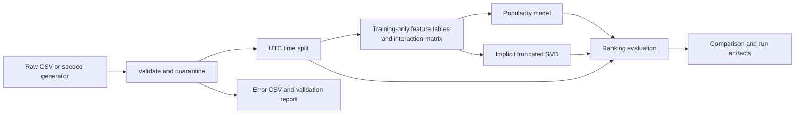

# Recommendation data pipeline

A local, reproducible batch workflow from raw CSVs to validated data, reusable features, two recommenders, and ranking evaluation. The included run uses **synthetic** movie interactions; no real customer data is present.

## Quick start

Requires Python 3.10+ and pip. From this directory:

```bash
python -m venv .venv
source .venv/bin/activate  # Windows: .venv\Scripts\activate
pip install -r requirements.txt
python dags/workflow.py
```

The workflow prints a JSON run log and returns a nonzero exit code on failure. It executes stages sequentially: ingestion, validation, time split, feature generation, model training, and evaluation. Each stage must succeed before the next starts. Schedule it, for example, using cron with an absolute path and an activated virtual environment: `0 2 * * * /path/to/.venv/bin/python /path/to/recommendation-pipeline/dags/workflow.py >> /path/to/pipeline.log 2>&1`. The schedule is an example, not installed by the project. Avoid overlapping runs: latest outputs are shared and are overwritten.

## Data and configuration

`configs/config.json` controls the source, seed, UTC cutoff, latent rank, and K. Synthetic generation uses seed 42, 120 users, 100 items, five categories and 35 distinct interactions per user over 300 days from 2024-01-01. User preferences bias item selection and ratings. Synthetic runs overwrite the raw CSVs. To use your own inputs, set `source` to `csv`, place these files in `data/raw/`, and set a suitable cutoff:

- `users.csv`: `user_id`, `age` (optional value, numeric 0–120), `region` (missing becomes Unknown).
- `items.csv`: `item_id`, `title`, `category` (required).
- `interactions.csv`: `user_id`, `item_id`, `rating` (1–5), `timestamp` (parseable date/time; timezone-naive values are treated as UTC).

Required fields, valid ages/ratings/timestamps, unique entity IDs, duplicate interaction keys, and references to accepted entities are checked. Rejected rows and reason codes are saved to `data/errors/`; accepted rows and counts are saved to `data/processed/` and `reports/validation_report.json`. For duplicate keys the first record is retained. Missing IDs and item attributes are rejected. Invalid rows may have several reasons. An absent required column or empty split fails the run.

## Architecture



## Features and serving

`data/features/` contains point-in-time user, item and interaction CSVs computed exclusively from events before the cutoff. They can be loaded by downstream batch training or prediction jobs; recompute them with the same cutoff and logic for a new snapshot. No online feature server is included. A matrix of interaction counts is in `data/processed/user_item_matrix.csv`. See [feature catalog](reports/feature_catalog.md). Missing activity/averages for entities with no training history remain null; item popularity is zero. Preferred-category ties break alphabetically.

The popularity model ranks training interaction counts, breaking ties by item ID. The personalized model uses a rank-12 truncated SVD of a binary implicit matrix and ranks its reconstructed scores. Both exclude items already seen in training. Cold users fall back to popularity; new items have no learned personalized signal. Example recommendations are in `reports/recommendations.json`; this batch implementation is not a production serving API.

## Evaluation protocol

A single global cutoff ensures no post-cutoff events enter training features. Test relevance is any distinct item interacted with at or after the cutoff, excluding training-seen items; ratings are not used as a relevance threshold. Every accepted catalog item is a candidate except seen items. Users without novel test items are excluded and counted. For each remaining user, precision is hits/K (even when fewer than K candidates), recall is hits/relevant items, and NDCG uses binary relevance with an ideal list of min(K, relevant count). Metrics are macro-averages across users. Coverage is unique recommended items divided by the accepted catalog size. Diversity is the mean per-user proportion of recommendation pairs with different categories (zero for fewer than two). No rating prediction is produced, so RMSE/MAE do not apply. No hyperparameter tuning is performed on the test set. See `reports/model_comparison.csv` for actual results.

## Experiment tracking and artifacts

Each invocation writes `runs/<run_id>.json` with config, UTC times, stage status/duration, input SHA-256 hashes and metrics. On success, `runs/<run_id>/` snapshots model files, parameters, validation, split and comparison reports; `models/` and `reports/` hold the latest outputs. These files form a lightweight local experiment tracker, not MLflow. On failure the log includes the traceback; partial latest outputs may remain and should not be treated as a successful run. Raw data and feature artifacts are overwritten, so archive input files externally for long-term provenance.

## Limitations

Synthetic preference patterns favor the model and do not establish real-world performance. A single split has no confidence intervals, and interaction presence is treated as positive regardless of rating. Dense SVD does not scale to large catalogs. Full-catalog offline ranking omits inventory, availability, propensity bias and business rules; category diversity is only a proxy. The system lacks incremental ingestion, production monitoring, access controls, concurrency locking and a deployment/online service. Evaluate temporal backtests, cold-start cohorts and real data before production.
